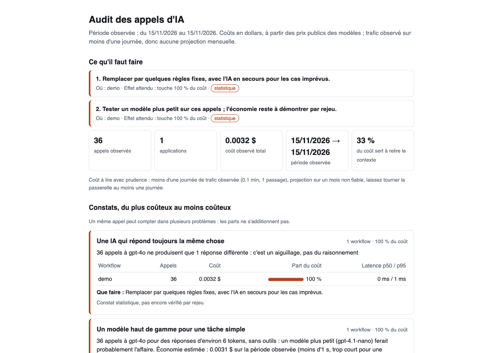

# DeadWeight

**Les entreprises ont embauché des milliers d'agents IA cette année. Personne ne leur a fait passer d'entretien annuel.**

DeadWeight lit l'historique de vos appels d'IA, repère ceux qui coûtent pour rien, et **prouve** chaque
économie avant de la proposer : il rejoue vos vrais appels sur la version modifiée et refuse tout changement
qui dégraderait les réponses.

- **Il se branche sur** : vos journaux Claude Code et Codex, vos workflows n8n, votre application OpenAI,
  Anthropic ou Gemini (une seule ligne à changer, le `base_url`), OpenTelemetry, Bedrock.
- **Il repère** : une IA qui répond toujours la même chose, un modèle trop gros pour la tâche, le même
  contexte relu à chaque appel, le cache inutilisé, des étapes faites en série au lieu de parallèle…
- **Il livre** : un rapport (« ce qu'il faut faire » en 2-3 actions), des petites modifications testées
  (précision, latence, coût), un diff prêt à appliquer et un message Slack.
- **Tout reste sur votre machine.** Aucune clé nécessaire pour essayer.

**Équipe** : Natan Lasar, Hugo Gesland, Thibault Gregori, Alexandre Zénou. Travaux antérieurs déclarés : voir
[Construit pendant le hackathon](#construit-pendant-le-hackathon-déclaration-des-travaux-antérieurs).



<sub>Le rapport de la démo (36 appels fictifs). Chaque chiffre est marqué mesuré, estimé ou non mesuré.</sub>

## Essayer en 5 minutes

Prérequis : Python 3.11+, git, make (macOS ou Linux). Aucune clé, aucun appel payant.

```sh
git clone https://github.com/hugogsld/DeadWeight.git && cd DeadWeight
make install        # crée .venv et installe
make demo           # 36 appels simulés → out/demo-…/audit.html (ouvrez-le)
```

Puis, avec votre propre usage de Claude Code (aucun zip, vos journaux restent sur votre machine) :

```sh
make audit-complet SOURCE=~/.claude/projects/<un-projet>    # un projet ; la liste s'affiche si vous oubliez
make audit-complet SOURCE=~/.claude/projects ALL=1          # tous vos projets : plus de volume, plus de constats
```

Enfin, pour votre propre application (OpenAI, Anthropic, Gemini) : `make dev` lance la passerelle locale sur
`http://127.0.0.1:8080/v1` ; vous ne changez que le `base_url` de votre client ([sections 1 à 4](docs/guide.md#1-installer-et-lancer-la-passerelle)).

Pour voir le message Slack et la page développeur sur l'historique d'exemple :

```sh
.venv/bin/python -m optimize fixtures/dataset/v1/events.jsonl --out out/optim --demo
```

Cette commande rejoue l'historique d'exemple, propose une modification par constat, la teste
(précision, latence, coût) et écrit `out/optim/slack.md` (le message Slack, avec sa légende ✅ ◻️ ⛔) et
`out/optim/propositions.html` (la page développeur). Ajoutez `--repo <chemin/du/depot>` pour obtenir aussi le
diff et le texte de chaque micro-PR ; le dépôt n'est pas modifié. Pour tout vérifier d'un coup : `make e2e`.

**Ce qui quitte votre machine.** Tout reste local (passerelle, base, rapports, rejeu des règles), sauf deux
fonctions que vous activez vous-même avec votre clé : l'agent auditeur (`DW_LLM_API_KEY`) et le banc de modèles
(`bench`) envoient des extraits de vos données (prompts, réponses) au fournisseur LLM que vous avez choisi.
Sans ces clés, rien n'est envoyé.


## Aller plus loin

Le [guide complet](docs/guide.md) : brancher la passerelle sur votre application, le scénario n8n,
l'audit complet en une commande, OpenTelemetry, Bedrock, l'agent auditeur, les prix des modèles,
la confidentialité et le dépannage.

## Équipe

Deadweight est construit par quatre personnes : **Natan Lasar**, **Hugo Gesland**, **Thibault Gregori** et
**Alexandre Zénou**.

---

## Construit pendant le hackathon (déclaration des travaux antérieurs)

Deadweight part d'un **prototype réalisé le 12 septembre 2026** au hackathon *Agents, Everywhere — AI Tinkerers
x OpenAI* (Paris), avant le hackathon X-IA. Nous le déclarons ici ; tout le reste a été construit les
**26 et 27 septembre 2026**. L'historique git le montre : 22 commits le 12/09 (de `e5fb548` à `0a65051`),
aucun entre le 13 et le 25/09, puis 123 commits et 82 PR fusionnées les 26 et 27/09 (au 27/09, compte arrêté
à 18 h 30).

| | Prototype du 12/09 (antérieur) | Construit les 26-27/09 (hackathon X-IA) |
|---|---|---|
| **Se brancher** | lecture d'une instance n8n uniquement | passerelle multi-fournisseurs (`gateway/`, une ligne `base_url`), OpenTelemetry (`connectors/otel.py`, `POST /v1/traces`), journaux Claude Code et Codex (`connectors/agent_logs/`), import de l'historique n8n (`importers/n8n/`), schéma d'événement commun |
| **Analyser** | une vérification (entropie des sorties, `detector/`) + `oversized_model` | 20 vérifications (`rules/`) : contexte relu, cache, boucles, agent au lieu d'une chaîne, étapes parallélisables, appel par élément, données hors d'Europe… |
| **Prouver** | rejeu d'un nœud n8n (`prover/`) | rejeu générique (`proof/`), banc de modèles (`bench/`), mode miroir et court-circuit, catalogue de modèles et souveraineté (`catalog/`) |
| **Coût** | prix OpenRouter pour la démo (`collector/`) | coût mesuré sur les prix réels, cache compris, période d'observation commune (`report/`) |
| **Livrer** | un patch n8n (`patcher/`) et un message Slack (`habitat/`) | **agent auditeur** (`agent/`) qui enquête avec des outils et ne cite que des chiffres produits par eux ; rapport HTML ; propositions testées, petites PR (n8n, alias de modèle) et message Slack des gains prouvés (`optimize/`) |
| **Qualité** | script de démo (`run.sh`) | 949 tests (27/09, 19 h), CI qui rejoue le parcours complet de la démo (`make e2e`) |

Les dossiers `detector/`, `prover/`, `patcher/`, `collector/`, `habitat/` et `workflows/` viennent du prototype.
Depuis, seuls deux fichiers y ont été modifiés : `collector/pricing.py` (prix avec cache) et `prover/prove.py`
(coûts en dollars). La section repliée ci-dessous garde, pour l'historique, le README du prototype (en anglais,
état du 12/09), suivi des notes techniques ajoutées pendant le week-end.

---

<details>
<summary>Historique : README du prototype (12/09) et notes techniques du week-end</summary>

*Archive, non mise à jour ; le parcours à jour est plus haut. Le début (jusqu'à « Running it ») et les
sections « Stack », « Not done yet » et « Team » sont le texte d'origine du prototype du 12/09 : ses
commandes et ses manques datent de ce jour-là. Les autres sections sont des notes techniques du week-end.*


**Companies hired thousands of agents this year. Nobody ever gave them a performance review.**

Deadweight is an agent that lives inside your n8n instance, audits your agentic
workflows against their real execution history, and ships a patch when a node
turns out not to need a model at all.

Built at *Agents, Everywhere — AI Tinkerers x OpenAI*, Paris, September 12 2026.

---

## The problem

Gartner expects **over 40% of agentic AI projects to be cancelled by the end of 2027** —
the top reasons being escalating cost and unclear business value. IBM puts enterprises
on track for roughly **1,600 agents each** by year end, with ~70% admitting they cannot
govern the ones they already run.

The tooling market answers the wrong question. Observability platforms **measure**
(Langfuse, Arize, Helicone, Datadog). Governance platforms **inventory** (Zenity, Astrix).
Cost tools **route and cache** (Sedai, Portkey, LiteLLM). None of them asks the one
question that actually cuts the bill:

> Did this ever need to be an agent?

## What Deadweight does

1. Reads your n8n workflows **and their execution history** through the public API.
2. Flags LLM nodes that are not reasoning — they are classifying.
3. Generates a patched workflow: a deterministic Switch, with a small model as fallback.
4. **Replays real past inputs** through the new path and compares against what the old
   node actually produced. Below the agreement threshold, it refuses to propose the patch.
5. Posts the review to Slack, and writes the patched workflow straight back into n8n.

## The signal: output entropy

Take an LLM node and look at its last 200 executions. If it only ever produced a handful
of distinct outputs, it is not reasoning — it is a switch statement billed at reasoning
prices. Shannon entropy over normalised outputs, three lines of Python, no model call
required to detect it.

On our demo workflow: **4 distinct outputs over 200 calls, 1.58 bits of entropy out of a
possible 7.64.**

## Architecture

    Collector  --> profile.json  --> Detector
    Detector   --> finding.json  --> Patcher
    Patcher    --> patch.json    --> Prover
    Prover     --> proof.json    --> Habitat (Slack + n8n)

Five stages, four JSON contracts. Each stage only knows the file it reads and the file
it writes — which is how three people built this in parallel in one afternoon.

**The LLM never writes the n8n JSON.** It only extracts classification rules from real
examples; Python assembles the workflow deterministically. n8n graphs have too many
structural traps — connections keyed by node name, `typeVersion`, required
`ai_languageModel` sub-nodes — to hand to a model under time pressure.

That is the product thesis applied to the product itself: a model where it earns its
place, code where code is enough. A `--no-llm` mode derives the same rules statistically,
and doubles as a baseline — if plain keyword rules reproduce the node's output, that is
further proof the node was replaceable.

## Measured results

Demo workflow: a support-ticket triage pipeline, GPT-5 classification node, 200 real
executions generated against a live n8n instance.

| | before | after |
| --- | --- | --- |
| agreement on replayed inputs | — | **98.0%** (93 by rules, 7 by fallback) |
| monthly cost | — | **/145** |
| p95 latency | 4,300 ms | **< 1 ms** on rule-matched inputs |
| inputs matched by rules | — | 98 / 100 |

The Prover's first run on real data returned **REJECT at 39% agreement** — rules derived
from too few examples. That is the system working: it refused to propose a patch that
would have broken production. Rebuilt from the real execution history, the same pipeline
returns **PASS at 98.0% agreement**.

## Running it

    export N8N_URL=http://localhost:5678
    export N8N_API_KEY=...        # n8n Settings > n8n API
    export OPENAI_API_KEY=...

    python3 prover/seed_original.py        # seed a workflow to audit
    python3 prover/seed_executions.py 200  # give it a real execution history
    python3 prover/refresh_finding.py      # detect: entropy over real outputs
    python3 patcher/patch.py fixtures/finding.json
    python3 patcher/validate_reimport.py out/patch.json
    python3 prover/prove.py out/patch.json fixtures/finding.json

Add `--no-llm` to the patcher to run the whole pipeline with no API key at all.

## Gateway (D1.1, D1.2, D1.3, D1.4) — OpenAI, Anthropic and Gemini pass-through proxy

The gateway sits between your application and OpenAI. You change one line — the
`base_url` — and every call is relayed unchanged, streaming included, while a copy
is captured in the event format of `schemas/event.schema.json`.

    python3 -m venv .venv && .venv/bin/pip install -r gateway/requirements.txt
    .venv/bin/python -m gateway          # listens on http://127.0.0.1:8080

Then, in your application:

    client = OpenAI(base_url="http://127.0.0.1:8080/v1")   # same API key as before
    client = Anthropic(base_url="http://127.0.0.1:8080/anthropic")
    client = genai.Client(http_options={"base_url": "http://127.0.0.1:8080/gemini"})

The three providers produce the same event: the rules and the report never need to know
which one a call came from. Anthropic `POST /v1/messages` and Gemini
`models/<model>:generateContent` / `:streamGenerateContent` are captured (Gemini streaming
both with `?alt=sse` and as a JSON array).

| Variable | Default | |
| --- | --- | --- |
| `GATEWAY_HOST` / `GATEWAY_PORT` | `127.0.0.1` / `8080` | listen address |
| `GATEWAY_OPENAI_UPSTREAM` | `https://api.openai.com` | where OpenAI calls are relayed |
| `GATEWAY_ANTHROPIC_UPSTREAM` | `https://api.anthropic.com` | where `/anthropic/...` is relayed |
| `GATEWAY_GEMINI_UPSTREAM` | `https://generativelanguage.googleapis.com` | where `/gemini/...` is relayed |
| `GATEWAY_DB` | `out/events.db` | SQLite file where captured calls are stored |
| `GATEWAY_LOG_LEVEL` | `INFO` | one summary line per call, never content or headers |

Optional headers: `x-deadweight-app` (groups calls by application, default `default`)
and `x-deadweight-trace` (groups calls of one workflow). They are not forwarded to OpenAI.

**Your API key is never stored.** The `Authorization` header (Anthropic `x-api-key`,
Gemini `x-goog-api-key` or `?key=`) is relayed as is and never persisted, logged or written
to an event; a key echoed back in an error message is masked before capture. Only the
completion routes above are captured; every other route is relayed without capture. With streaming, token counts are only known if the client sets
`stream_options: {"include_usage": true}` — the gateway never alters the request.

Every captured call is written to SQLite in a background thread, never on the response
path. The database stays on your machine. Once your normal traffic has run for a while:

    .venv/bin/python -m gateway.store count                          # calls captured so far
    .venv/bin/python -m gateway.store export > out/events.jsonl      # --app <app_id> to filter
    .venv/bin/python -m report.audit out/events.jsonl -o out/audit.html

Stop the gateway with Ctrl+C or SIGTERM: pending events are flushed before it exits.

**Streaming token counts.** OpenAI only reports usage in a stream when the client sets
`stream_options.include_usage`. When the client says nothing, the gateway asks for it and
removes that extra usage chunk before relaying: the client gets the same bytes as a direct
call, and the event gets real token counts. A client that sets `include_usage` either way
is left alone.

**Traces.** `export` groups the calls of one workflow into traces (`trace.id`, `trace.step`),
which the loop and context rules need. If your application sets `x-deadweight-trace`, that
id is used as is. Otherwise the gateway infers it: a call continues an earlier one when it
carries that call's last input message followed by its answer — what every chat client and
agent loop sends back — within 30 minutes, same app and same system prompt. Isolated calls
stay out of traces. Details and known blind spots in `gateway/traces.py`; on the reference
dataset it recovers 79 / 79 traces with no header and no false positive. `--raw` exports
without grouping.

Checks, no API key needed (a local fake OpenAI stands in):

    .venv/bin/pip install pytest jsonschema openai
    .venv/bin/python -m pytest tests/test_gateway.py tests/test_store.py tests/test_traces.py
    .venv/bin/python -m gateway.bench                   # added latency, with and without SQLite

Measured on a laptop, p95 added over a direct call: **+0.3 ms** sequential and **+3.0 ms**
at 20 concurrent requests with SQLite on — SQLite itself adds under 1 ms (target: < 30 ms).
Checked against the real OpenAI API with the official SDK, plain and streaming.

## Replay (D3.2) — agreement threshold at 0.95

Replays the extracted rules (D3.1) on real captured events and compares against what
the original model actually answered. Extraction examples are excluded: the proof runs
on independent data. Inputs no rule covers stay on the original call; agreement is
measured on the inputs the new path replaces, and at least 30 are needed to conclude.

    python3 -m proof.replay fixtures/dataset/v1/events.jsonl   # writes out/proof-<finding>.json

A **reject** is a result, not an error: the verdict lists its reasons and the exit code is 0.
Costs are in USD, `null` when not measurable — never a default value.

Optional fallback model for uncovered inputs, via any OpenAI-compatible endpoint:

    export DW_LLM_BASE_URL=https://api.openai.com/v1 DW_LLM_API_KEY=...
    python3 -m proof.replay events.jsonl --fallback-model gpt-4o-mini --max-calls 50 --min-interval 1

The fallback is the only thing that calls an API: hard cap of 200 calls per replay
(`--max-calls` cannot exceed it) and a minimum interval between two calls.

## Banc de modèles (M2.2) — tester un modèle avant de le recommander

Avant que M2 (recommandations) propose de remplacer un modèle, le banc le teste pour de
vrai sur l'échantillon d'entrées **réelles** d'un groupe (`app_id` x modèle x gabarit de
prompt, comme `low_entropy_output`) : mêmes entrées, réponse du modèle d'origine comme
référence. Aucun appel réseau tant que `--dry-run` n'est pas levé.

    python -m bench run fixtures/dataset/v1/events.jsonl --app mail-triage --model gpt-4o \
        --dry-run                                    # ce qui serait appelé, coût estimé, 0 appel
    python -m bench run fixtures/dataset/v1/events.jsonl --app mail-triage --model gpt-4o \
        --candidates small,local --max-cases 50 --out out/bench.json

Type de tâche détecté automatiquement à partir des références : **classification** (peu de
réponses distinctes, comme `low_entropy_output`) jugée par égalité stricte après
normalisation, seuil **0.95** ; **texte libre** jugé par recouvrement de tokens (F1), seuil
**0.5** indicatif seulement — un point d'extension pour un LLM-juge est documenté dans
`bench/scoring.py` mais pas implémenté (bruit et coût à ce stade). Chaque candidat est
mesuré : latence p50/p95, taux d'erreur, coût pour 1000 appels (`report.cost.lookup` sur
`fixtures/pricing.json`, `0 $` pour l'exécution locale), et marqué de son origine
(FR/EU/US/CN, `bench/candidates.json`, curé depuis `docs/research/modeles.md`). Plafond dur
d'appels par candidat (`bench.runner.HARD_MAX_CALLS`, comme `proof.replay.Throttle`).

Candidats réels, un point de terminaison OpenAI-compatible par nature de fournisseur :

    export OPENROUTER_API_KEY=...                 # une seule clé pour les ~10 candidats OpenRouter
    export OPENAI_API_KEY=... MISTRAL_API_KEY=...  # candidats en API directe (gpt-5-*, ministral-8b)
    ollama pull llama3.3:70b && ollama serve        # candidats locaux : http://localhost:11434/v1, aucune clé
    python -m bench run events.jsonl --app mon-app --model gpt-4o --max-calls 50 --min-interval 1

`bench/candidates.json` est une bibliothèque : `gateway/bench.py` mesure la latence de la
passerelle, ce banc mesure des modèles candidats sur du trafic — deux choses différentes
malgré le nom voisin. M2 (catalogue, recommandations) appelle ce module comme une
bibliothèque ; il ne le remplace pas.

Les options que M2 propose pour un constat « modèle trop gros » passent au banc telles
quelles, chacune sur la route qu'elle recommande (Mistral via Mistral, au prix de Mistral),
puis le rapport affiche le verdict mesuré au lieu de « qualité non prouvée » :

    export OPENROUTER_API_KEY=...
    python -m bench m2 events.jsonl --finding <finding_id> --dry-run   # ce qui serait appelé, et son coût
    python -m bench m2 events.jsonl --finding <finding_id>             # écrit out/banc/banc-<finding_id>.json
    python -m report.audit events.jsonl --banc out/banc

## Short-circuit (D3.3) — the gateway answers proven calls itself

Off by default. Point the gateway at the replay output: only **pass** proofs are loaded.

    GATEWAY_SHORTCIRCUIT=out/ .venv/bin/python -m gateway

A call is answered by the gateway, without reaching OpenAI, only when it falls in the
proven group (same `x-deadweight-app`, model and system prompt template) **and** a rule
covers its input. Tools, images, JSON output, `n > 1` and uncovered inputs are relayed
unchanged. Streaming works. The response carries `x-deadweight-shortcircuit: <finding_id>`
and is still captured, with `upstream: "deadweight"`, `model_resolved: "deadweight-rules"`
and zero tokens.

On the D0.3 dataset (`mail-triage`): **0.24 ms p95** instead of 764 ms for the original
gpt-4o call, no upstream request.

## Mirror mode (D4.3) — measure the rules on live traffic, never apply them

The step before the short-circuit. Off by default; loads **pass and reject** proofs, since
a rule refused at replay is exactly what you want to keep watching.

    GATEWAY_MIRROR=out/ .venv/bin/python -m gateway
    .venv/bin/python -m gateway.mirror stats        # agreement per finding

Every captured call (OpenAI, Anthropic or Gemini) that falls in a proven group is compared
with what the rules would have answered. **The client always gets the model's answer**:
the mirror hooks into capture, not into the relay. `out/mirror.jsonl` (`GATEWAY_MIRROR_LOG`)
holds the rules' label and whether it agreed — never the prompt or the model's text.
`stats` says, per finding, how many calls were covered, the agreement rate, and whether it
reaches the 0.95 threshold to switch on the short-circuit. Short-circuited calls are not
mirrored (there is no model answer to compare).

## Stack

**n8n** — the audited target: the only orchestrator exposing both workflow JSON and
execution history over an API. **OpenAI** — rule extraction via structured outputs.
**OpenRouter** — model pricing catalogue, which turns "this node is oversized" into a
cost factor. **CopilotKit** — the Slack habitat, with human-in-the-loop approval in the
channel. **Google Cloud Run** — deployment.

## Not done yet (prototype, 12/09)

*Depuis, fait pendant le hackathon : les cinq règles citées (voir `rules/`) et la lecture des traces
OpenTelemetry (voir [OpenTelemetry](docs/guide.md#opentelemetry)).*

Five of the six detector rules (`oversized_model`, `raw_context`, `no_cache`,
`unbounded_loop`, `agent_where_chain`) — only output entropy is wired end to end.
Scheduled weekly scans via Trigger.dev. Generalisation beyond n8n through
OpenTelemetry GenAI traces. Patch strategies other than `rule_switch`.

## Team (prototype, 12/09)

Built in one afternoon at Le Wagon Paris. Three people, three lanes, four JSON contracts.

*Équipe du hackathon X-IA : voir [Équipe](#équipe).*

## Rapport d'audit (D4.1)

    python -m report.audit fixtures/dataset/v1/events.jsonl -o out/audit.html

Lance toutes les règles présentes dans `rules/`, chiffre chaque constat et écrit une page HTML
autonome dans `out/audit.html`.

## Démarrer (D0.2)

Python 3.11+ requis.

    git clone https://github.com/hugogsld/DeadWeight.git && cd DeadWeight
    make dev       # cree .venv, installe, cree .env.local depuis .env.example, lance la passerelle

Tes clés vont dans `.env.local` (jamais commité). Personne ne tape `export`.

    make test      # tests, sans réseau ni clé : les réponses fournisseurs sont rejouées
    make lint      # ruff, sur gateway/ rules/ report/ tests/ scripts/
    make record    # appelle les vraies API une fois et écrit tests/cassettes/

Un test qui parle à un fournisseur se marque `@pytest.mark.vcr` : il rejoue sa cassette
dans `tests/cassettes/`. Les clés sont retirées avant l'écriture (voir `tests/conftest.py`).

</details>
